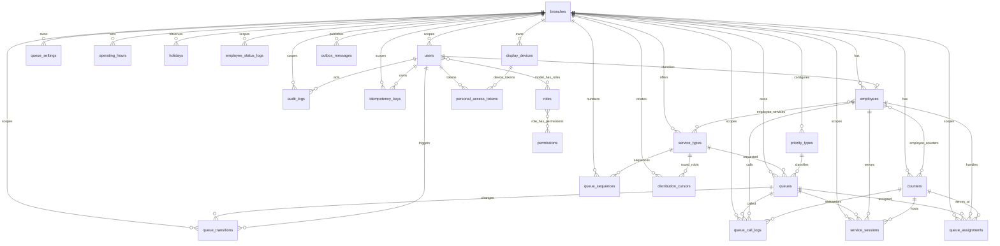

# SQMS — Final Database ERD

> Diperbarui 31 Oktober 2026. Perubahan sejak blueprint awal: `display_devices.device_type` (DISPLAY/KIOSK), `queue_settings.display_announcement`, tabel `distribution_cursors` dan `personal_access_tokens` (token perangkat memakai relasi polimorfik ke `display_devices`), serta tabel infrastruktur `cache`, `cache_locks`, `jobs`, `job_batches`, `failed_jobs`.

Semua primary key adalah UUID. Semua tabel transaksi/operasional membawa `branch_id`. Composite foreign key `(entity_id, branch_id)` digunakan pada relasi lintas aggregate untuk mencegah ID dari cabang berbeda dipasangkan.

## Invariant database

- `queue_sequences` unique pada `(branch_id, service_type_id, queue_date)`; generator nomor wajib mengunci row dengan `FOR UPDATE`.
- `queues` unique pada `(branch_id, service_type_id, queue_date, sequence_no)`; nomor publik dibentuk dari prefix + sequence.
- Partial unique index hanya mengizinkan satu assignment aktif per queue, employee, dan counter; hal yang sama berlaku untuk service session.
- FK komposit memastikan service, employee, counter, priority, dan queue selalu berasal dari cabang yang sama.
- Event real-time dikirim setelah commit memakai `ShouldDispatchAfterCommit` milik Laravel. **`outbox_messages` dan `idempotency_keys` sudah ada di skema tetapi belum dipakai kode** (dicadangkan bila nanti dibutuhkan jaminan pengiriman lintas worker atau retry command idempotent).
- Soft delete (`deleted_at`) pada `branches`, `employees`, `service_types`, `counters`, `priority_types`, `display_devices`. Kode tetap dicadangkan oleh unique constraint walau datanya dihapus; query mentah (`DB::table`) wajib menambahkan `whereNull('deleted_at')`.
- `display_devices.device_type` dibatasi CHECK (`DISPLAY`,`KIOSK`) pada PostgreSQL.
