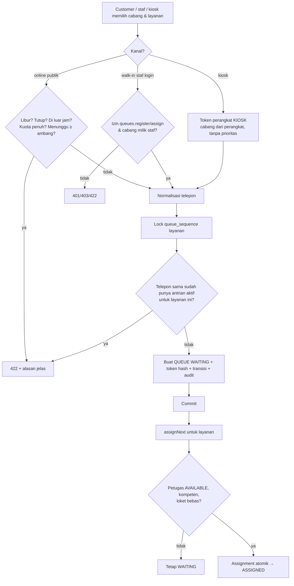
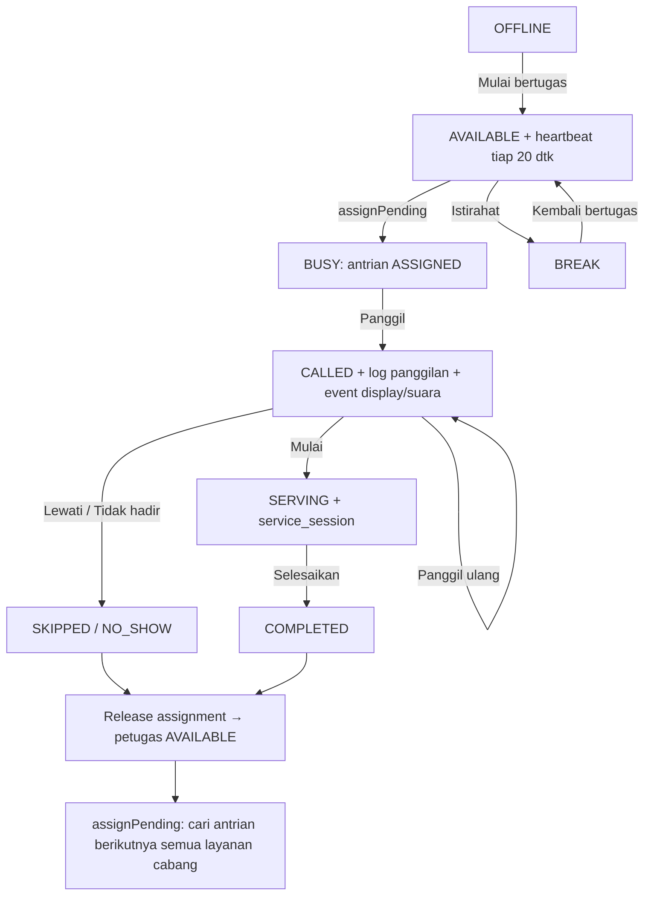

# Business Process Flow

> Diperbarui 31 Oktober 2026 sesuai implementasi.

## 1. Pendaftaran antrian

- Pendaftaran **online**: menerima token pelacakan; kuota & ambang diperiksa di bawah advisory lock PostgreSQL per cabang agar tidak terlampaui saat serentak.
- **Walk-in** tidak dibatasi jam operasional/kuota online. Prioritas hanya diterima dari staf berizin `queues.assign`.
- Pemeriksaan duplikat telepon dilakukan **setelah** baris sequence terkunci (serialisasi per cabang+layanan+hari).

## 2. Pelayanan oleh petugas

- Petugas yang masih punya antrian aktif **tidak dapat** istirahat/offline (409).
- Heartbeat tidak mengubah status (BREAK tetap BREAK). Heartbeat basi (> `stale_heartbeat_seconds`) membuat petugas tidak dipilih distribusi, tetapi sesi pelayanannya tidak otomatis ditutup.
- Auto-assign juga dijalankan saat antrian dibatalkan, petugas kembali tersedia, atau heartbeat diterima.
- Klik ganda aksi yang sama ditolak (403/409) karena state machine dan lock, bukan idempotency key.

## 3. Pelacakan dan pembatalan customer
Token → posisi (skor prioritas + aging) → estimasi = ⌈antrian di depan ÷ petugas aktif⌉ × rata-rata durasi layanan (+ ½ layanan berjalan bila ada yang sibuk). Estimasi `null` bila tidak ada petugas aktif. Pembatalan berlaku untuk WAITING/ASSIGNED/CALLED dan membebaskan petugas serta kuota online.

## 4. Central Display dan Kiosk
- Perangkat dipasangkan sekali: admin membuat perangkat (tipe DISPLAY/KIOSK) → kunci pairing tampil sekali → perangkat menukar kunci dengan token 7 hari (diperpanjang otomatis; rotate/revoke mengakhiri akses).
- Display: snapshot REST (sumber kebenaran) + event WebSocket; setelah reconnect ambil snapshot ulang; suara hanya untuk event baru yang belum kedaluwarsa dan belum pernah diproses.
- **Video TV:** daftar sumber berurutan dari pengaturan cabang. Pemutar mencoba sumber 1; "tersambung" = benar-benar mulai memutar (stream: event `playing`; YouTube: status `playing` dari player) dalam 12–15 detik, jika tidak → sumber berikutnya. Semua gagal → panel "Video tidak tersambung" dan ulang dari sumber 1 tiap 30 detik. Selagi memakai cadangan, sumber yang lebih prioritas dicoba diam-diam (pemutar tersembunyi, tanpa suara) tiap 3 menit dan dipakai begitu tersambung. Video selalu bisu agar tidak menutupi pengumuman panggilan.
- Kiosk: layanan → nama (+telepon opsional) → tiket dengan QR pelacakan, cetak opsional, kembali ke awal otomatis (25 dtk / 90 dtk idle).

## 5. Pengelolaan data master
Tambah → ubah → nonaktifkan → hapus (soft) → **pulihkan**. Penonaktifan/penghapusan ditolak (409) bila data sedang dipakai (antrian aktif, loket melayani, petugas melayani, cabang masih punya data turunan). Menonaktifkan/menghapus petugas mengakhiri semua sesi login, menutup status (CLOSED), dan memblokir login. Pemulihan ditolak bila cabang induk masih terhapus; hubungan petugas–layanan/loket harus diatur ulang.
